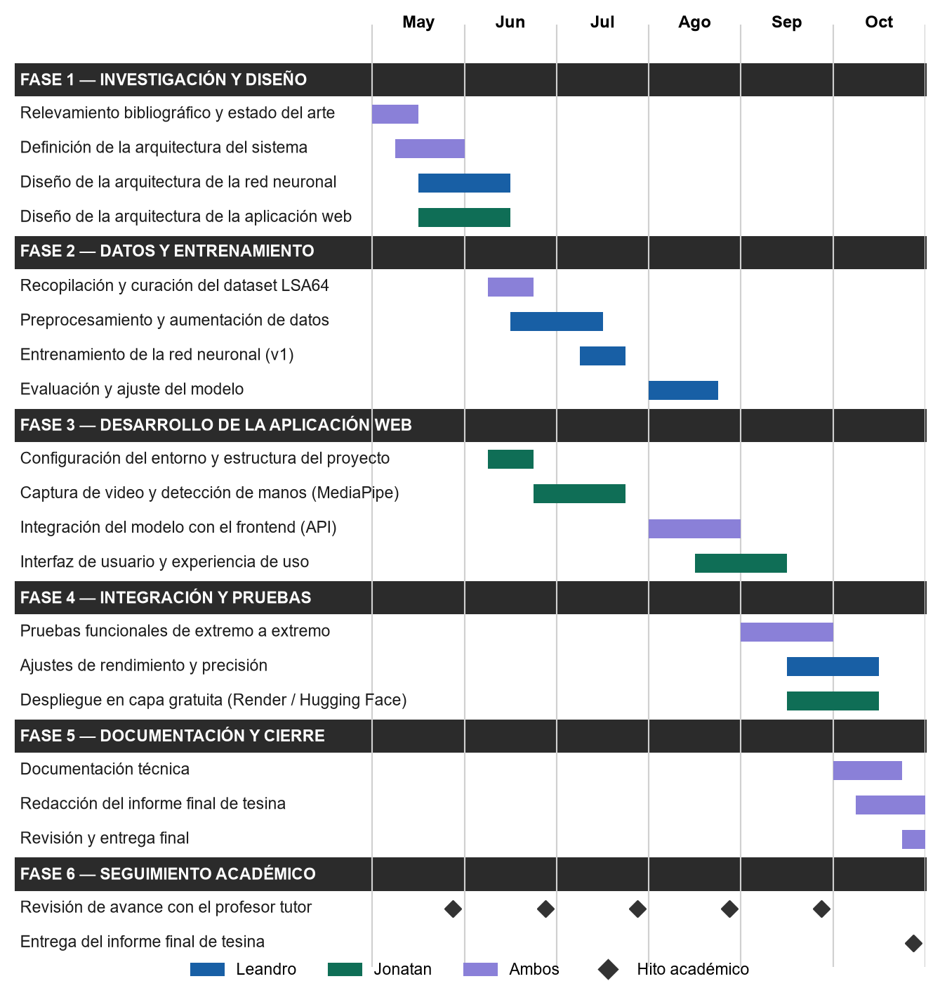
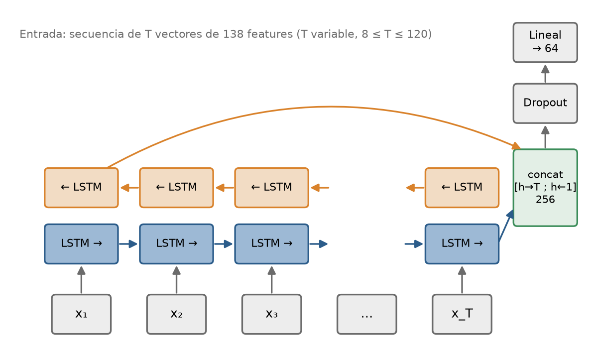
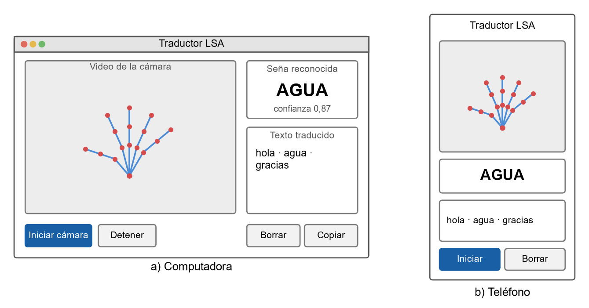

# 1. Tema del anteproyecto

Se trata de un sistema de traducción de la Lengua de Señas Argentina (LSA) a texto, compuesto por una red neuronal entrenada para reconocer señas de la LSA y por una aplicación web capaz de detectar las señas en tiempo real a través de la cámara del dispositivo, con el fin de facilitar la comunicación entre personas sordas y personas oyentes que no conocen la lengua.

# 2. Objetivos del proyecto

## 2.1 Objetivo general

Desarrollar una aplicación basada en inteligencia artificial que permita la traducción en tiempo real de la Lengua de Señas Argentina a texto.

## 2.2 Objetivos específicos

1. Diseñar la arquitectura de la red neuronal y la del sistema que la integra con la aplicación web, y documentarlas mediante diagramas de componentes y de capas (Anexo B).
2. Entrenar una red neuronal con conjuntos de datos de LSA que cubran el abecedario y las palabras clave definidas en el Anexo E, y medir su exactitud sobre datos que no se hayan utilizado durante el entrenamiento.
3. Desarrollar la aplicación web que capture video desde la cámara del dispositivo, envíe la información al modelo y muestre la traducción como texto en tiempo real (Anexo C).
4. Desplegar la aplicación en una plataforma en la nube, dentro de los límites de una capa gratuita, de modo que sea accesible desde computadoras y dispositivos móviles.

# 3. Alcances y limitaciones

## 3.1 Alcances

El proyecto abarcará:

- El desarrollo de una aplicación web con traducción en tiempo real, accesible desde el navegador de computadoras y dispositivos móviles.
- El reconocimiento del abecedario de la Lengua de Señas Argentina (alfabeto manual).
- La identificación de un conjunto de palabras clave previamente definidas, de uso en contextos cotidianos (Anexo E).
- La implementación del sistema en una plataforma web de acceso público.

El trabajo se circunscribe a la Lengua de Señas Argentina, utilizada por la comunidad sorda de la República Argentina, y está orientado a interacciones breves de la vida cotidiana, como la atención al público, los trámites o las compras.

Quedan fuera del alcance:

- La traducción de frases completas o de la lengua de señas continua: la traducción se limita a señas aisladas del abecedario y de las palabras clave.
- La interpretación de estructuras gramaticales complejas y de los componentes no manuales de la lengua (expresión facial, movimiento corporal).
- La traducción en sentido inverso, de texto a lengua de señas.

## 3.2 Limitaciones

- **Tiempo.** El proyecto se desarrollará en seis meses (mayo a octubre de 2026) por dos personas, lo que acota la cantidad de señas que pueden incorporarse y evaluarse.
- **Recursos económicos.** El despliegue deberá mantenerse dentro de los límites de la capa gratuita de servicios como AWS, Google Cloud o Render, lo que restringe la capacidad de cómputo y la cantidad de usuarios simultáneos.
- **Acceso a datos.** Los conjuntos de datos públicos de LSA son escasos y fueron grabados en condiciones controladas, por lo que el desempeño con cámaras domésticas y en entornos reales puede ser menor que el medido en el laboratorio.
- **Condiciones de uso.** El reconocimiento estará restringido a condiciones de iluminación adecuadas, a una calidad de cámara mínima y a que la persona se ubique frente a la cámara, con las manos dentro del encuadre.

# 4. Justificación del proyecto

El proyecto surge como respuesta a las dificultades de comunicación que enfrenta la comunidad sorda en distintos ámbitos de la vida cotidiana. En la Argentina, la Ley 27.710 (2023) reconoce a la Lengua de Señas Argentina como una lengua natural y originaria; sin embargo, la mayor parte de las tecnologías de comunicación fueron diseñadas para la lengua hablada o escrita, y la comunicación entre una persona sorda y una persona oyente que no conoce la LSA depende, en general, de la presencia de un intérprete.

**Aporte y solución.** La investigación aportará un sistema que reconoce señas de la LSA a partir de la cámara de un dispositivo común y muestra su traducción como texto, sin equipamiento especial. La solución propuesta permitirá:

- Facilitar la comunicación en tiempo real entre personas sordas y oyentes en interacciones breves.
- Reducir la dependencia de intérpretes humanos en situaciones donde no hay uno disponible, sin pretender reemplazarlos.
- Promover la inclusión social y la igualdad de oportunidades.

**Beneficios.**

- **Sociales:** mejora de la calidad de vida y de la inclusión de las personas sordas, al facilitar su acceso a servicios y trámites cotidianos.
- **Económicos:** la herramienta será gratuita y funcionará con la cámara de cualquier computadora o teléfono, por lo que instituciones y comercios podrían utilizarla sin inversión en equipamiento.
- **Académicos:** el proyecto integra áreas centrales de la Licenciatura en Sistemas de Información (análisis y diseño de sistemas, desarrollo web, arquitectura cliente-servidor, aprendizaje automático, pruebas y despliegue) y dejará un antecedente documentado para la Universidad sobre el reconocimiento de la LSA, una línea de investigación con escasos trabajos en el país.

# 5. Resultados esperados

Al concluir el proyecto se espera obtener:

1. **Un modelo de inteligencia artificial** entrenado con técnicas de aprendizaje profundo, especializado en el reconocimiento del abecedario y de las palabras clave del Anexo E, con su exactitud medida y documentada sobre datos no utilizados en el entrenamiento. El modelo se desarrollará y entrenará en entornos de ciencia de datos basados en Python y Jupyter Notebook, a partir de conjuntos de datos de LSA.
2. **Una aplicación web funcional**, desarrollada con React y FastAPI, capaz de capturar video en tiempo real mediante la cámara del dispositivo, detectar la posición y el movimiento de las manos con técnicas de visión por computadora, procesar la información con el modelo y mostrar la traducción correspondiente en formato de texto.
3. **La aplicación desplegada** en una plataforma web accesible desde computadoras y dispositivos móviles.
4. **El código fuente** versionado en un repositorio de GitHub.
5. **El informe final de tesina**, que documentará el desarrollo, los resultados de la evaluación y las conclusiones.

# 6. Planteamiento del problema

El problema consiste en la dificultad de comunicación entre las personas sordas que se expresan en Lengua de Señas Argentina y las personas oyentes que no la conocen. Se representa mediante el esquema de la caja negra (Krick, 1995), con un estado actual (A), en el que existe el problema, y un estado futuro (B), en el que se alcanza la solución.

Tabla: Planteamiento del problema según el esquema de la caja negra.

| Estado actual (A) | Estado futuro (B) |
|---|---|
| Dificultades de comunicación entre personas sordas y oyentes en la vida cotidiana. | Comunicación más fluida en interacciones breves, con el apoyo de una aplicación. |
| Dependencia de intérpretes, que son escasos y no siempre están disponibles. | Traducción automática de señas a texto disponible en cualquier momento, sin intermediarios. |
| Falta de herramientas accesibles, gratuitas y adaptadas a la Lengua de Señas Argentina. | Una aplicación web gratuita, que funciona con la cámara del dispositivo. |
| Barreras de acceso a servicios y trámites para la comunidad sorda. | Mayor inclusión social de las personas sordas. |

# 7. Antecedentes del proyecto

El reconocimiento automático de lengua de señas es un área de investigación activa que combina visión por computadora, aprendizaje automático e interacción humano-computadora (Koller, 2020).

Según la Organización Mundial de la Salud (2021), más de 1500 millones de personas en el mundo viven con algún grado de pérdida auditiva, y alrededor de 430 millones presentan una pérdida discapacitante. La Federación Mundial de Sordos (s.f.) estima que más de 70 millones de personas sordas utilizan alguna de las más de 300 lenguas de señas existentes como principal medio de comunicación. A pesar de esta realidad, la mayoría de las tecnologías de comunicación fueron desarrolladas para la lengua hablada o escrita, lo que genera una barrera sistemática de acceso para la comunidad sorda.

El antecedente más relevante para este proyecto es el trabajo del Instituto de Investigación en Informática LIDI de la Universidad Nacional de La Plata. Ronchetti et al. (2016) presentaron LSA64, el primer conjunto de datos público de Lengua de Señas Argentina, que contiene 3200 videos de 64 señas realizadas por 10 personas, grabados con cámaras RGB convencionales (Anexo A). Este conjunto constituyó la primera base de datos orientada específicamente al entrenamiento de modelos de aprendizaje automático para la LSA, y sigue siendo la referencia principal del área.

Sobre esta base, Mindlin (2021) desarrolló modelos de clasificación con redes neuronales convolucionales y recurrentes sobre LSA64, y alcanzó una tasa de acierto del 99,4 % en el mejor de los casos. Este resultado demuestra la viabilidad técnica del reconocimiento automatizado de señas de la LSA, aunque corresponde a una evaluación en la que las mismas personas aparecen en los datos de entrenamiento y de prueba, por lo que no mide el desempeño con personas nuevas. Además, el trabajo se limitó a un entorno de laboratorio y no contempló una interfaz de usuario en tiempo real ni un despliegue web.

Si bien existen sistemas de reconocimiento de lengua de señas con alto nivel de precisión para lenguas como la Lengua de Señas Americana (ASL), la Lengua de Signos Española (LSE) o la Lengua Brasileña de Señas (LIBRAS), ninguno de los trabajos revisados aborda el reconocimiento de la LSA en tiempo real mediante una aplicación web accesible. Los trabajos existentes sobre LSA se circunscriben a entornos académicos de laboratorio, sin contemplar la integración en una plataforma de uso cotidiano. El presente proyecto busca cerrar esta brecha con un sistema funcional, accesible desde el navegador de computadoras y dispositivos móviles, que opere en tiempo real con la sola cámara del dispositivo.

# 8. Metodología de la investigación y técnicas a utilizar

## 8.1 Tipo de investigación

Se trata de una investigación aplicada, orientada a resolver un problema concreto mediante el desarrollo de un sistema, con un componente experimental: el desempeño del modelo se medirá de forma cuantitativa sobre datos que no se hayan utilizado durante el entrenamiento.

## 8.2 Etapas de la investigación

La investigación se desarrollará en las siguientes etapas secuenciales, que se corresponden con las fases del cronograma (sección 9):

1. **Relevamiento bibliográfico y del estado del arte.** Revisión de trabajos sobre reconocimiento de lengua de señas, conjuntos de datos de LSA y técnicas de aprendizaje profundo aplicadas a video.
2. **Diseño.** Definición de la arquitectura del sistema (cliente, servidor y modelo) y de la arquitectura de la red neuronal (Anexo B).
3. **Recopilación y preparación de los datos.** Obtención y curación del conjunto LSA64 y de los datos del abecedario; extracción de los puntos de referencia de las manos y aumentación de datos.
4. **Entrenamiento y evaluación del modelo.** Entrenamiento de la red neuronal y medición de su exactitud sobre un conjunto de prueba separado, con análisis de los errores mediante la matriz de confusión.
5. **Desarrollo de la aplicación web.** Captura de video, detección de manos con MediaPipe e integración con el modelo mediante una API.
6. **Integración y pruebas.** Pruebas funcionales de extremo a extremo y ajustes de rendimiento y precisión.
7. **Despliegue** en una plataforma en la nube de capa gratuita.
8. **Documentación** y redacción del informe final.

## 8.3 Técnicas

- **Visión por computadora:** detección de las manos y estimación de sus puntos de referencia en cada cuadro del video con MediaPipe.
- **Aprendizaje profundo:** redes neuronales para la clasificación de secuencias (Goodfellow et al., 2016; Géron, 2022).
- **Evaluación experimental:** separación de los datos en entrenamiento y prueba, y métricas de exactitud y matriz de confusión.
- **Pruebas de software:** pruebas funcionales de extremo a extremo de la aplicación.

## 8.4 Gestión del proyecto

Para la gestión del desarrollo se adoptará una metodología ágil basada en Scrum, adaptada al contexto de un equipo de dos personas sin rol de Scrum Master. Esta elección se justifica por la naturaleza iterativa e incremental del proyecto: el modelo de inteligencia artificial y la aplicación web se desarrollarán en paralelo, lo que requiere ciclos cortos de integración y ajuste continuo.

El trabajo se organizará en sprints de dos semanas, cada uno con objetivos concretos y un entregable verificable. Al inicio de cada sprint se planificará el trabajo a realizar y, al final, se llevará a cabo una revisión del avance y una retrospectiva de mejora del proceso. Las tareas se gestionarán mediante un tablero Kanban con tres estados (por hacer, en progreso y completado), en Trello o en GitHub Projects.

# 9. Cronograma de actividades

La @fig:gantt presenta las actividades del proyecto distribuidas por mes y por semana, agrupadas en cinco fases técnicas y una de seguimiento académico. Cada mes se divide en cuatro semanas.

{ancho=16 #fig:gantt}

# 10. Recursos a utilizar

## 10.1 Recursos humanos

**Investigadores:**

- **Leandro Provenzano**, responsable principal del diseño, el entrenamiento y la evaluación de la red neuronal, de la integración del modelo con el backend y de la documentación técnica.
- **Jonatan Videla**, responsable del desarrollo de la aplicación web, de la captura de video en tiempo real, de la integración con el frontend y del despliegue.

**Asesores:**

- Profesor de tesina: Mario Alberto Mirallas.
- Profesor tutor: Marcelo Palma.

La @tab:horas estima la dedicación en horas-hombre a partir del cronograma, con una dedicación de 10 horas semanales por investigador durante las 24 semanas del proyecto.

Tabla: Dedicación estimada en horas-hombre. {#tab:horas}

| Recurso | Cantidad | Dedicación | Horas-hombre |
|---|---|---|---|
| Investigadores | 2 | 10 h semanales durante 24 semanas | 480 |
| Asesores (revisiones de avance) | 2 | 1 h por revisión, 6 revisiones | 12 |
| **Total** | | | **492** |

## 10.2 Recursos tecnológicos

**Hardware:**

- Dos computadoras portátiles con procesadores de 8 núcleos y 16 GB de memoria RAM, una por investigador.
- Cámara web integrada o externa de al menos 720p, para la captura de señas durante las pruebas.
- Unidad de procesamiento gráfico (GPU) dedicada a través de Google Colab Pro.

**Software:**

- Python 3.10 o superior, como lenguaje principal para el desarrollo del modelo.
- Jupyter Notebook, para entrenar el modelo de manera local, o Google Colab, para hacerlo en la nube.
- Bibliotecas: TensorFlow o PyTorch, OpenCV, MediaPipe, NumPy, scikit-learn y Matplotlib.
- React, para el desarrollo del frontend de la aplicación web.
- FastAPI, para exponer el modelo como servicio.
- Git y GitHub, para el control de versiones y el trabajo colaborativo.
- Trello o GitHub Projects, para la gestión del tablero Kanban.
- Visual Studio Code, como editor de código principal.

**Plataformas y servicios:**

- Render, Hugging Face Spaces o Google Cloud (capa gratuita), para el despliegue de la aplicación.
- Google Drive, para el almacenamiento y respaldo de datos y artefactos del proyecto.

## 10.3 Recursos materiales

El proyecto no requiere materiales consumibles específicos, como placas o sensores: la captura de las señas se realizará con las cámaras de los equipos existentes. Los únicos materiales previstos son la impresión y la encuadernación de los ejemplares del informe final.

## 10.4 Recursos financieros

La @tab:costos cuantifica todos los recursos en dólares estadounidenses, para obtener el monto total del proyecto. Los equipos ya son propiedad de los investigadores, por lo que se computa sólo su amortización durante el período del proyecto; el software es libre o gratuito y el despliegue se realizará en una capa gratuita.

Tabla: Presupuesto estimado del proyecto (valores de referencia en dólares estadounidenses). {#tab:costos}

| Concepto | Detalle | Costo (USD) |
|---|---|---|
| Horas de los investigadores | 480 horas-hombre a USD 10 por hora | 4800 |
| Equipamiento | Amortización de 2 computadoras (USD 900 cada una, vida útil de 36 meses) durante 6 meses | 300 |
| Conexión a Internet | 2 conexiones a USD 20 mensuales durante 6 meses | 240 |
| Google Colab Pro | USD 10 mensuales durante los 3 meses de entrenamiento | 30 |
| Software y bibliotecas | Libres o gratuitos | 0 |
| Despliegue | Capa gratuita de la plataforma | 0 |
| Materiales | Impresión y encuadernación del informe final | 25 |
| Asesores | A cargo de la Universidad | 0 |
| **Total** | | **5395** |

# 11. Bibliografía a utilizar

**Tesis y trabajos de graduación**

Mindlin, I. (2021). *Reconocimiento de lengua de señas con redes neuronales recurrentes* [Tesina de licenciatura, Universidad Nacional de La Plata]. SEDICI. http://sedici.unlp.edu.ar/handle/10915/129853

**Libros**

Géron, A. (2022). *Hands-on machine learning with Scikit-Learn, Keras, and TensorFlow* (3.ª ed.). O'Reilly Media.

Goodfellow, I., Bengio, Y., y Courville, A. (2016). *Deep learning*. MIT Press. https://www.deeplearningbook.org

Krick, E. V. (1995). *Introducción a la ingeniería y al diseño en la ingeniería*. Limusa.

**Artículos y publicaciones científicas**

Koller, O. (2020). *Quantitative survey of the state of the art in sign language recognition* (arXiv:2008.09918). arXiv. https://arxiv.org/abs/2008.09918

Ronchetti, F., Quiroga, F., Estrebou, C., Lanzarini, L., y Rosete, A. (2016). LSA64: A dataset of Argentinian Sign Language. En *XXII Congreso Argentino de Ciencias de la Computación (CACIC 2016)*. https://facundoq.github.io/datasets/lsa64/

**Informes, organismos y normativa**

Federación Mundial de Sordos. (s.f.). *Our work*. https://wfdeaf.org

Ley 27.710 de 2023. Lengua de Señas Argentina. 3 de mayo de 2023. Boletín Oficial de la República Argentina, N.º 35.162. https://www.argentina.gob.ar/normativa/nacional/ley-27710-383041/texto

Organización Mundial de la Salud. (2021). *World report on hearing*. https://www.who.int/publications/i/item/9789240020481

**Recursos en Internet**

Google. (s.f.). *MediaPipe*. https://developers.google.com/mediapipe

Google. (s.f.). *TensorFlow API documentation*. https://www.tensorflow.org/api_docs

Meta Open Source. (s.f.). *React*. https://react.dev

Ramírez, S. (s.f.). *FastAPI*. https://fastapi.tiangolo.com

# 12. Anexos

## Anexo A — Conjunto de datos LSA64

LSA64 (Ronchetti et al., 2016) es el conjunto de datos que se utilizará para entrenar el reconocimiento de las palabras clave. La @tab:lsa64 resume sus características. Las imágenes de ejemplo de cada seña se publican en el sitio del conjunto de datos, citado en la bibliografía.

Tabla: Características del conjunto de datos LSA64. {#tab:lsa64}

| Característica | Valor |
|---|---|
| Origen | Instituto de Investigación en Informática LIDI, Universidad Nacional de La Plata |
| Cantidad de señas | 64 (42 de una mano y 22 de dos manos) |
| Personas | 10, no expertas y diestras |
| Repeticiones | 5 por seña y por persona |
| Total de videos | 3200 |
| Resolución y frecuencia | 1920 × 1080 píxeles, 60 cuadros por segundo |
| Condiciones de grabación | Fondo blanco, vestimenta negra y guantes de colores |
| Licencia | Creative Commons de uso no comercial |

## Anexo B — Arquitectura propuesta de la red neuronal

Las señas de la LSA son gestos que se desarrollan en el tiempo, por lo que el modelo deberá procesar secuencias. Se propone una red neuronal recurrente bidireccional (BiLSTM) que recibe, para cada cuadro del video, el vector de coordenadas de los puntos de referencia de las manos que estima MediaPipe, recorre la secuencia en ambos sentidos y clasifica la seña con una capa lineal (@fig:red). Trabajar sobre puntos de referencia, en lugar de sobre los píxeles del video, reduce el tamaño del modelo y permite ejecutarlo sin GPU en el servidor de despliegue.

{ancho=14 #fig:red}

Tabla: Parámetros de configuración iniciales de la red. {#tab:red}

| Parámetro | Valor inicial |
|---|---|
| Entrada por cuadro | Vector de características calculado a partir de los 21 puntos de referencia de cada mano |
| Capa recurrente | LSTM bidireccional, 128 unidades por sentido |
| Regularización | Dropout de 0,2 antes de la capa de salida |
| Salida | Capa lineal con una neurona por seña |
| Función de pérdida | Entropía cruzada |
| Optimizador | Adam |

Estos valores son el punto de partida; se ajustarán durante la etapa de evaluación (sección 8.2).

## Anexo C — Bocetos de la aplicación web

La @fig:wireframe muestra los bocetos de la pantalla principal de la aplicación: la vista de captura de video, con los puntos de referencia de la mano dibujados sobre la imagen, y la visualización de la seña reconocida y del texto traducido acumulado, en computadora y en teléfono.

{ancho=16 #fig:wireframe}

## Anexo D — Glosario de términos técnicos

Tabla: Glosario de términos técnicos. {#tab:glosario}

| Término | Definición |
|---|---|
| Alfabeto manual | Conjunto de configuraciones de la mano que representan las letras del alfabeto, utilizado para deletrear. |
| Aprendizaje automático | Rama de la inteligencia artificial que estudia algoritmos que mejoran su desempeño a partir de datos. |
| Aprendizaje profundo | Aprendizaje automático con redes neuronales de muchas capas, que aprenden sus propias representaciones de los datos. |
| API | Interfaz de programación de aplicaciones: conjunto de operaciones que un sistema expone para que otros lo utilicen. |
| BiLSTM | Red LSTM bidireccional: dos redes LSTM que recorren la secuencia en sentidos opuestos. |
| Capa gratuita | Nivel de uso sin costo que ofrecen las plataformas en la nube, con límites de cómputo y de tráfico. |
| Exactitud | Proporción de ejemplos clasificados correctamente por un modelo. |
| Lengua de Señas Argentina (LSA) | Lengua natural visoespacial de la comunidad sorda argentina, reconocida por la Ley 27.710. |
| LSTM | Red neuronal recurrente con una celda de memoria y compuertas, capaz de aprender dependencias de largo plazo. |
| Matriz de confusión | Tabla que cruza las clases reales con las predichas y muestra cada tipo de error. |
| MediaPipe | Marco de trabajo de Google para procesos de percepción; su solución de manos estima 21 puntos de referencia por mano. |
| Puntos de referencia | Puntos del cuerpo o de la mano estimados en una imagen; en inglés, *landmarks*. |
| Red neuronal artificial | Modelo compuesto por unidades simples interconectadas cuyos parámetros se ajustan a partir de datos. |
| Red neuronal convolucional | Red especializada en datos con estructura espacial, como las imágenes. |
| Red neuronal recurrente | Red que procesa secuencias manteniendo un estado que resume lo visto hasta el momento. |
| Tiempo real | Procesamiento con una demora lo bastante breve como para acompañar la interacción sin interrumpirla. |
| Visión por computadora | Área de la inteligencia artificial que extrae información de imágenes y videos. |

## Anexo E — Tabla de señas objetivo

La versión inicial del sistema buscará reconocer las 27 letras del abecedario de la LSA (de la A a la Z, incluida la Ñ) y las 64 palabras clave de la @tab:senas, que corresponden a las señas del conjunto LSA64.

Tabla: Palabras clave que el sistema buscará reconocer. {#tab:senas}

| N.º | Seña | N.º | Seña | N.º | Seña | N.º | Seña |
|---|---|---|---|---|---|---|---|
| 1 | Opaco | 17 | Llamar | 33 | Hambre | 49 | Yogur |
| 2 | Rojo | 18 | Espumadera | 34 | Mapa | 50 | Aceptar |
| 3 | Verde | 19 | Amargo | 35 | Moneda | 51 | Agradecer |
| 4 | Amarillo | 20 | Dulce de leche | 36 | Música | 52 | Apagar |
| 5 | Brillante | 21 | Leche | 37 | Nave | 53 | Aparecer |
| 6 | Celeste | 22 | Agua | 38 | Ninguno | 54 | Aterrizar |
| 7 | Colores | 23 | Comida | 39 | Nombre | 55 | Atrapar |
| 8 | Rosa | 24 | Argentina | 40 | Paciencia | 56 | Ayudar |
| 9 | Mujer | 25 | Uruguay | 41 | Perfume | 57 | Bailar |
| 10 | Enemigo | 26 | País | 42 | Sordo | 58 | Bañarse |
| 11 | Hijo | 27 | Apellido | 43 | Trampa | 59 | Comprar |
| 12 | Hombre | 28 | Dónde | 44 | Arroz | 60 | Copiar |
| 13 | Lejos | 29 | Burlarse | 45 | Asado | 61 | Correr |
| 14 | Cajón | 30 | Cumpleaños | 46 | Caramelo | 62 | Darse cuenta |
| 15 | Nacer | 31 | Desayuno | 47 | Chicle | 63 | Dar |
| 16 | Aprender | 32 | Foto | 48 | Fideos | 64 | Encontrar |
